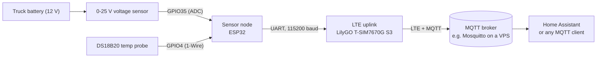
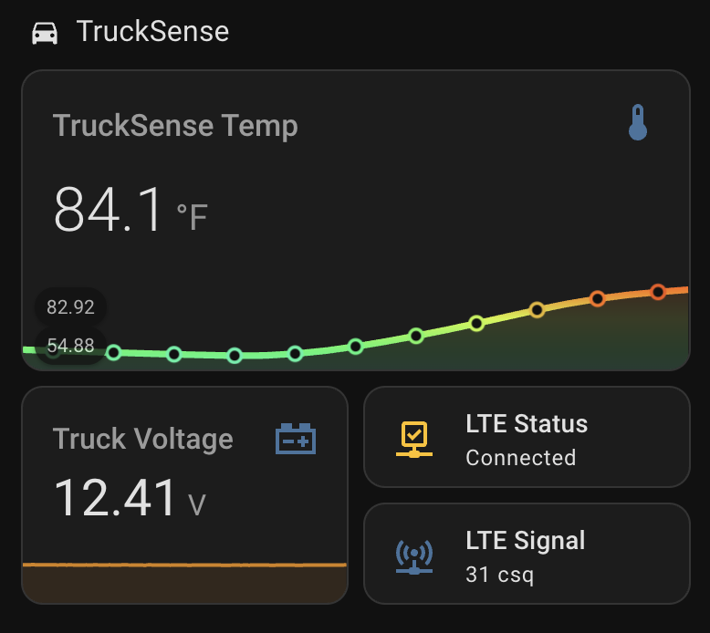

# TruckSense

Remote battery-voltage and temperature monitoring for a vehicle that isn't parked at home.

TruckSense is a two-board ESP32 system that lives in the truck, reads the battery voltage and outside air temperature, and sends the readings over LTE to an MQTT broker. From there you can watch them in Home Assistant or any MQTT client, so you can see whether the battery is healthy without walking out to the truck.

It's built to run unattended for weeks. Both boards have hardware watchdogs, every reconnect is bounded, and the uplink reboots itself if it stays offline too long. Every heartbeat also reports why the board last rebooted.

---

## How it works



Sensing and the cellular link run on separate boards, connected by a one-way serial line. Either board can hang, reboot and recover without taking the other down.

<p align="center">
  
</p>
<p align="center"><em>TruckSense data in a Home Assistant dashboard. The firmware publishes °C, and Home Assistant converts it to your preferred unit.</em></p>

### Sensor node: `TruckSense_Sensor_v2`

Every ~5 seconds it:

1. Averages 20 ADC samples from the voltage divider and converts them to volts (calibrated against a multimeter).
2. Reads the DS18B20 for the outside temperature in °C.
3. Sends one line to the uplink over UART:

   ```
   V=13.020,T=24.600
   V=12.880,T=nan        <- temperature probe not responding
   ```

A 15-second hardware watchdog reboots the board if it ever hangs, for example on a locked 1-Wire bus.

### LTE uplink: `TruckSense_LTE_v2`

1. Powers up the SIM7670G modem, registers on the LTE network and opens a data session with your carrier's APN.
2. Connects to the MQTT broker with a Last Will, so the broker marks the truck `offline` automatically if the connection drops.
3. Reads the sensor lines and caches the latest valid values. Readings outside 0–20 V or −50 to 90 °C are discarded as noise.
4. Publishes on a fixed schedule, with every message retained.

### MQTT topics

All topics start with `trucksense/hino01/`. Change `hino01` to your own vehicle ID in `TruckSense_LTE_v2.ino`.

| Topic | Example payload | Interval |
|---|---|---|
| `voltage` | `13.020` | 20 s |
| `temp_outside` | `24.600` (°C) | 20 s |
| `status` | `online` / `offline` | On connect / disconnect (LWT) |
| `heartbeat` | `uptime_s=3600 sensor_age_ms=1200 boots=1 last_reset=POWERON` | 10 s |
| `sensor_link` | `age_ms=1200 lastV=13.02 lastT=24.6` | 15 s |
| `wifi` | `CSQ=18 IP=10.0.0.5` | 3 min |

> `wifi` is a legacy topic name kept for compatibility. It reports the LTE signal quality (CSQ) and the modem's IP address.

### Self-healing

| Mechanism | Uplink | Sensor node |
|---|---|---|
| Hardware watchdog (reboots if `loop()` hangs) | 180 s | 15 s |
| Reconnect | One bounded attempt every 5 s; re-checks LTE registration and the data session first | n/a |
| Escalation | Reboots after 4 min continuously offline; reboots if the modem fails to start 10 times in a row | n/a |
| Diagnostics | `boots` counter (kept in RTC memory, so it survives soft resets but clears on power loss) and `last_reset` reason (`POWERON`, `SW`, `TASK_WDT`, `BROWNOUT`, `PANIC`…) | Reset reason printed on boot |

That combination tells you what happened after an outage. If `boots` keeps climbing, the board is rebooting itself. If `boots` drops back to 1, it lost power completely. `BROWNOUT` points to a weak supply or a loose wire.

### Status LED (uplink, GPIO2)

| Pattern | Meaning |
|---|---|
| Off | Booting and starting the modem |
| Fast blink | No LTE connection |
| Double blink | LTE up, but can't reach the MQTT broker |
| Solid | Connected and publishing |

Set `LED_PIN` to `-1` if you don't use an LED.

---

## Repository layout

```
TruckSense_LTE_v2/            LTE uplink firmware (LilyGO T-SIM7670G S3)
  TruckSense_LTE_v2.ino
  secrets.h.example           template: copy to secrets.h and fill in
TruckSense_Sensor_v2/         Sensor node firmware (ESP32)
  TruckSense_Sensor_v2.ino
legacy/
  TruckSense_LTE_v1/          previous uplink build, kept for reference
libraries/
  TinyGSM-fork-master.zip     TinyGSM fork used by the uplink
docs/images/                  screenshots used in this README
```

Each sketch sits in a folder with the same name, which the Arduino IDE requires.

---

## Setup (Arduino IDE)

### 1. Install the ESP32 board support

1. Install [Arduino IDE 2.x](https://www.arduino.cc/en/software).
2. Open **Tools → Board → Boards Manager**, search for **esp32**, and install **esp32 by Espressif Systems**. The firmware supports both the 2.x and 3.x cores.

### 2. Install the libraries

| Library | Used by | How to install |
|---|---|---|
| TinyGSM Fork (LilyGO / [lewisxhe](https://github.com/lewisxhe/TinyGSM-fork)) | Uplink | **Sketch → Include Library → Add .ZIP Library…** and pick `libraries/TinyGSM-fork-master.zip` |
| PubSubClient (Nick O'Leary) | Uplink | Library Manager |
| OneWire | Sensor node | Library Manager |
| DallasTemperature | Sensor node | Library Manager |

> Don't also install the regular **TinyGSM** from the Library Manager. Both provide `TinyGsmClient.h`, and the IDE may pick the wrong one.

### 3. Wire it up

**Sensor node (ESP32)**

| ESP32 pin | Connects to |
|---|---|
| GPIO35 | Voltage sensor signal pin (`S`) |
| GPIO4 | DS18B20 data, with a 4.7 kΩ pull-up resistor to 3.3 V |
| 3.3V | DS18B20 VDD |
| GPIO17 (TX2) | LilyGO **GPIO44** (RX) |
| GPIO16 (RX2) | LilyGO GPIO43 (TX). Optional, currently unused |
| GND | LilyGO GND, voltage sensor `−`, DS18B20 GND |

Connect the voltage sensor's input terminals to the battery (`VCC` to +, `GND` to −).

> **The two boards must share a ground.** The UART link won't work without it.

Power both boards with 5 V, for example from a 12 V → 5 V buck converter on the truck battery. See [Hardware requirements](#hardware-requirements).

### 4. Add your credentials

```bash
cp TruckSense_LTE_v2/secrets.h.example TruckSense_LTE_v2/secrets.h
```

Edit `secrets.h` with your carrier's APN, your broker's address and port, the MQTT username and password, and a client ID. `secrets.h` is listed in `.gitignore`, so it never gets committed.

### 5. Flash the sensor node

1. Open `TruckSense_Sensor_v2/TruckSense_Sensor_v2.ino`.
2. Select **Tools → Board → ESP32 Dev Module** and the board's port, then click **Upload**.
3. Open the Serial Monitor at **115200** baud. A line like `TX: V=12.640,T=21.500` should appear every 5 s.
4. **Calibrate the voltage:** measure the battery with a multimeter, then set
   `VOLTAGE_MULTIPLIER = VOLTAGE_MULTIPLIER × (multimeter reading ÷ reported reading)` and re-upload.

### 6. Flash the LTE uplink

1. Insert an activated SIM card and connect the LTE antenna.
2. Open `TruckSense_LTE_v2/TruckSense_LTE_v2.ino`.
3. Select **Tools → Board → ESP32S3 Dev Module** and set **USB CDC On Boot → Enabled**. This sends `Serial` logs over USB and leaves GPIO43/44 free for the sensor link. For flash size and PSRAM, use the settings LilyGO recommends for the T-SIM7670G S3.
4. Upload, then open the Serial Monitor at **115200** baud. You should see:

   ```
   Network connected
   Data connected
   MQTT connected
   System ready
   ```

### 7. Check that data reaches the broker

From any machine with the Mosquitto clients installed:

```bash
mosquitto_sub -h <broker> -p 1883 -u <user> -P <password> -t 'trucksense/#' -v
```

### 8. Optional: Home Assistant

Add MQTT sensors to `configuration.yaml`:

```yaml
mqtt:
  sensor:
    - name: "Truck Battery Voltage"
      state_topic: "trucksense/hino01/voltage"
      unit_of_measurement: "V"
      device_class: voltage
      state_class: measurement
      availability_topic: "trucksense/hino01/status"
      payload_available: "online"
      payload_not_available: "offline"

    - name: "Truck Outside Temperature"
      state_topic: "trucksense/hino01/temp_outside"
      unit_of_measurement: "°C"
      device_class: temperature
      state_class: measurement
      availability_topic: "trucksense/hino01/status"
      payload_available: "online"
      payload_not_available: "offline"
```

---

## Tuning

The main knobs are constants near the top of `TruckSense_LTE_v2.ino`:

| Constant | Default | What it does |
|---|---|---|
| `PUBLISH_INTERVAL_MS` | 20 s | How often voltage and temperature are sent. Raise it to use less data |
| `REBOOT_IF_DOWN_MS` | 4 min | How long the uplink stays offline before rebooting |
| `MQTT_KEEPALIVE_S` | 60 s | MQTT keepalive. Values much lower than this caused false disconnects over LTE |
| `WDT_TIMEOUT_S` | 180 s | Watchdog timeout |

---

## Version history

**v2 (current)**
- Uplink: removed Bluetooth/BLE, which frees a big chunk of RAM and helps long-run stability.
- Uplink: MQTT keepalive restored to 60 s. The 30 s keepalive in v1 caused false disconnects over LTE.
- Uplink: removed v1's forced reconnect every 10 minutes, which showed up as real "offline" blips over cellular.
- Sensor node: added a hardware watchdog, so it recovers from hangs such as a locked 1-Wire bus.

**v1** ([`legacy/TruckSense_LTE_v1`](legacy/TruckSense_LTE_v1))
- First self-healing uplink: hardware watchdog, non-blocking bounded reconnects, throttled publishing, reboot escalation, capped UART reads, heartbeat diagnostics and a BLE debug console.

---

## Roadmap

- **Engine temperature** (planned): a second temperature reading for the engine, alongside the outside air temperature.

## Notes

- MQTT runs over plain TCP (port 1883, no TLS). Use a broker account that's dedicated to this device.
- The system draws power continuously from the truck battery while it runs.

## License

TruckSense is released under the [Apache License 2.0](LICENSE). The bundled TinyGSM fork (`libraries/TinyGSM-fork-master.zip`) keeps its own LGPL-3.0 license.

---

## Hardware requirements

| Component | Role | Notes |
|---|---|---|
| **LilyGO T-SIM7670G S3** | LTE uplink | ESP32-S3 with a SIMCom SIM7670G LTE Cat-1 modem |
| **ESP32 dev board** (HiLetGo ESP-WROOM-32) | Sensor node | Any classic ESP32 that exposes GPIO35, GPIO4 and GPIO17 |
| **0–25 V DC voltage sensor module** | Battery voltage | 5:1 divider. On the ESP32's ADC it tops out around 16 V, which covers a 12 V system (about 14.5 V while charging) |
| **DS18B20 temperature sensor** | Outside air temperature | The waterproof probe version is best for mounting outside |
| **4.7 kΩ resistor** | 1-Wire pull-up | Between DS18B20 data and 3.3 V |
| **SIM card with an LTE data plan** | Cellular data | You'll need the carrier's APN for `secrets.h` |
| **LTE antenna** | Cellular | Usually included with the LilyGO board |
| **12 V → 5 V DC-DC buck converter** | Powers both boards from the truck battery | Rated for 2 A or more. A weak supply causes brownout resets when the modem transmits |
| Hookup wire, inline fuse | Wiring | Fusing the battery tap is recommended |

**Also needed (software):** an MQTT broker the truck can reach over the internet, such as Mosquitto on a VPS, and something to view the data, such as Home Assistant.
